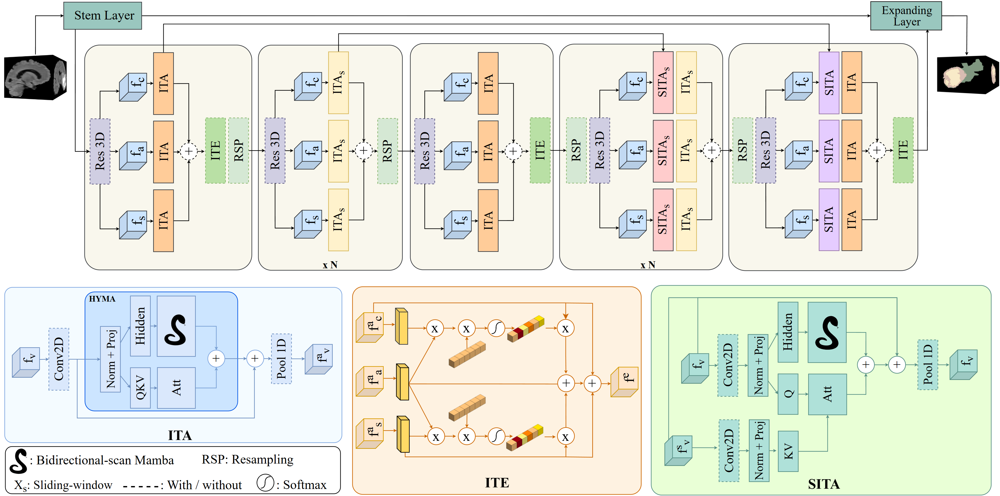

# Hymavi: Hybrid Mamba-Attention Network for Medical Image Segmentation
(This code is used for review process)

## Overview
Hymavi is a **hybrid architecture** that integrates **Mamba-based sequence modeling** and **attention mechanisms** in a parallel framework for **3D medical image segmentation**


<!-- ## Features
- **Parallel Hybrid Mamba-Attention (HYMA) Block** for efficient spatial and contextual modeling.
- **Multi-View/Cross-View Learning** for leveraging complementary anatomical information.
- **Optimized U-Net inspired architecture** for volumetric medical image segmentation.
- **Benchmark Results** on **BraTS2023, ACDC, and AMOS22** datasets. -->

## Installation

### 1. Create and activate a Conda environment:
```bash
conda create --name hymavi python=3.8
conda activate hymavi
```

### 2. Install PyTorch and dependencies:
```bash
pip install torch==1.11.0+cu113 torchvision==0.12.0+cu113 --extra-index-url https://download.pytorch.org/whl/cu113
pip install -r requirements.txt
```

## Datasets
Prepare your datasets following the structure below:

### **AMOS22 Dataset**
```bash
./DATASET_AMOS22/
  ├── hymavi_raw/
      ├── hymavi_raw_data/
           ├── Task02_AMOS22/
              ├── imagesTr/
              ├── imagesTs/
              ├── labelsTr/
              ├── labelsTs/
              ├── dataset.json
```


## Training
Run the following scripts to train Hymavi on different datasets:
```bash
bash training_scripts/run_training_amos.sh
```

## Evaluation
### 1. Download pre-trained weights for AMOS22.
https://drive.google.com/file/d/10ZSbCRABc6spCxO-7Fwkg6MVEwwNu45S/view?usp=sharing

### 2. Place the weights in the appropriate folder:
output_amos/hymavi/3d_fullres/Task008_AMOS/hymavi_trainer_amos__hymavi_pp_Plansv2.1/fold_0

### 3. Run the evaluation script:
```bash
bash evaluation_scripts/run_evaluation_amos.sh
```

## Results
Hymavi achieves **state-of-the-art** performance on multiple benchmarks:

| **Dataset**  | **Metric** | **Hymavi** |
|-------------|-----------|------------|
| BraTS2023   | DSC       | 91.28      |
| ACDC        | DSC       | 92.67      |
| AMOS22      | DSC       | 87.33      |

